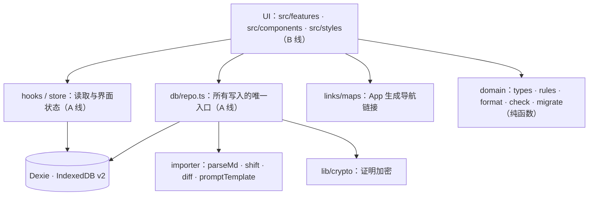
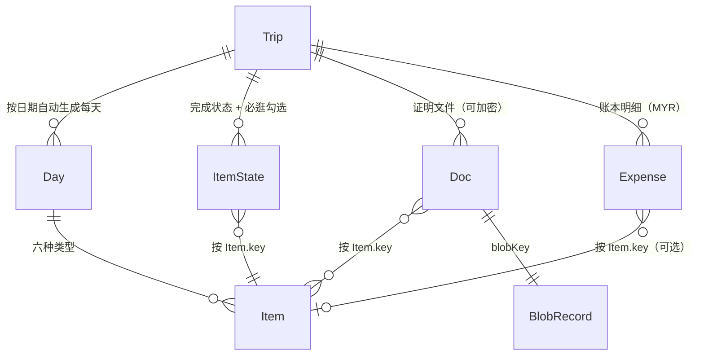
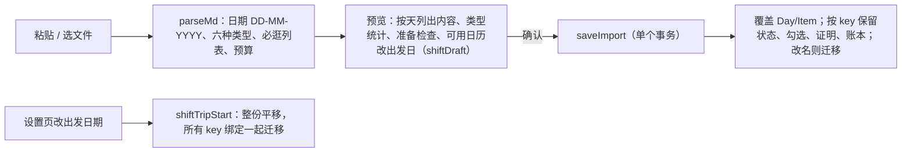

# 架构与数据结构 v2（B 线只读）

本地优先：所有数据在浏览器 IndexedDB（Dexie，版本 3），无后端、无 App 内 AI。
用户在自己的 ChatGPT / Claude 里用「导入模板」的提示词整理行程，贴回 App 导入。

## 分层（依赖只能向下）

## 数据模型

### Trip
`title` 就是目的地（城市级以上，如「北海道，日本」）；`startDate/endDate`；`budget`（分，MYR，只有它从导入来）。

### Item（六种类型，公共字段 + 专属字段）
| 类型 | 中文 | 专属字段 |
|---|---|---|
| flight | 机票 | `flight { number, airline, terminal, seat }`，`place`=出发机场，`toPlace`=到达机场 |
| lodging | 住宿 | `lodging { checkIn, checkOut, roomType }` |
| spot | 景点 | `mustDo[]`（必逛 / 必体验） |
| meal | 餐饮 | `meal`（breakfast/lunch/dinner/snack），`mustDo[]`（必吃） |
| transit | 交通 | `transit { mode, line }`，`place`=起点，`toPlace`=终点 |
| note | 其他 | — |

公共字段：`title start end endDayOffset timeNote place toPlace bookingRef bookingStatus note alt fixed meta src navUrl`。
`navUrl` 只是 AI 给的备选；实际导航由 `links/maps.ts` 用「当地语言名 + 地址」生成（中国大陆用高德，其他用设置里的地图）。

### 用户内容（重新导入必须保留）
- `ItemState { status, checked[] }`：完成 / 跳过；必逛、必吃已勾选的文字。
- `Doc { lock? }`：有 `lock` 表示 blob 是密文（AES-GCM，PBKDF2 从密码导出），密码不保存，忘记无法恢复。
- `Doc { codeKind?, url?, app? }`（2026-10）：`codeKind='static'` 自己保存的二维码 / 票码图片；`'dynamic'` 动态票码（只能现场在 App 打开）。只有链接的资料 `mime='text/uri-list'`、`blobKey='link:<id>'`，本机没有文件，不算附件。离线状态见 `domain/bookings.ts`。
- `Expense { date, amount(分), title, category, itemKey? }`：账本，目前只有 MYR。

- `Garment`（衣橱，所有旅程共用，照片在 blobs `garment:<id>`）、`Outfit [tripId+dayIndex]`（每日穿搭，按 Day 序号绑定，改出发日期不用迁移）、`PackItem`（衣物以外的打包物品）、`PackCheck [tripId+ref]`（已装，ref = `garment:<id>` / `item:<id>`）。Dexie v3 新增这四张表；旅行包带上这份旅程的穿搭、打包和用到的衣物。

它们都**不引用 Item.id**，只引用 `Item.key = 日期|type|标题slug`（同日重名加 `#n`）。

## 导入 / 重新导入 / 改期

## 导入后编辑（2026-10-15）
在 App 里新增 / 编辑 / 删除 / 上下移动行程项，改当天主题、城市、旅程名称。每次编辑后：按导入同样的规则重算整份旅程的 `Item.key`，变化的把完成状态、证明、账本绑定迁移过去；再用 `importer/serialize.ts` 把整份旅程写回标准 MD 存进 `Trip.sourceMd`（并更新每项原文行号），所以「重新导入」「查看原文」看到的都是改过的内容。写回的 MD 用 `parseMd` 读回结果一致（`serialize.test.ts`）。

## 显示格式
日期 `13-JAN-2027`（`fmtDate`），短格式 `13-JAN`；金额 `RM 1,234.50`（`fmtMoney`）。
