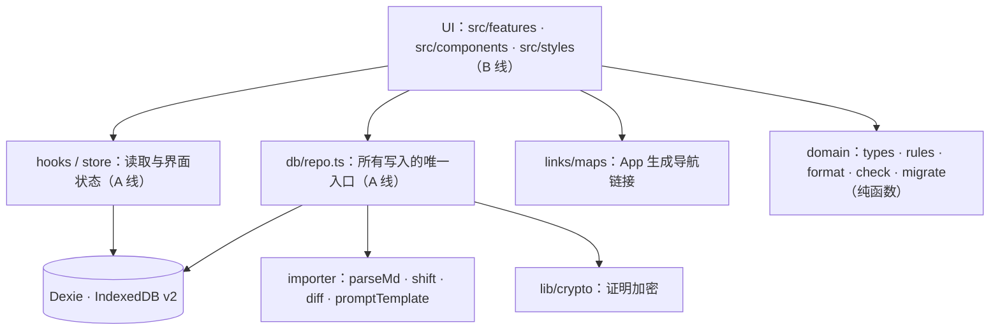
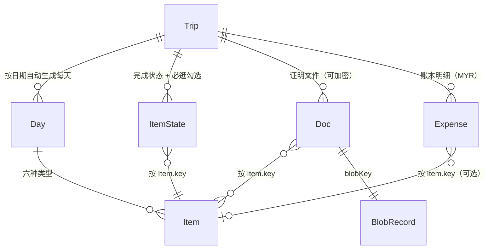
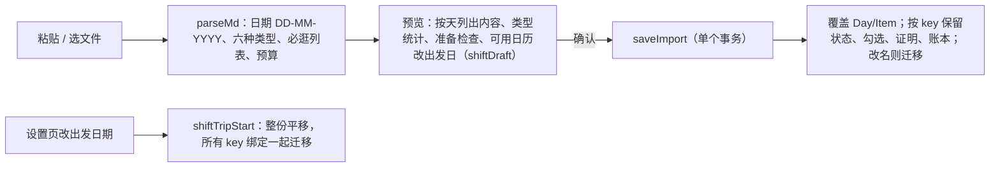

# 架构与数据结构 v2（B 线只读）

本地优先：所有数据在浏览器 IndexedDB（Dexie，版本 3），无后端、无 App 内 AI。
用户在自己的 ChatGPT / Claude 里用「导入模板」的提示词整理行程，贴回 App 导入。

## 分层（依赖只能向下）

## 数据模型

### Trip
`title` 就是目的地（城市级以上，如「北海道，日本」）；`startDate/endDate`；`budget`（分，MYR，只有它从导入来；导入没写总预算时用各项预算合计）。

### Item（六种类型，公共字段 + 专属字段）
公共字段里的 `budget`（2026-10-22，分，MYR，全部同行人合计，0 = 免费）是这一项的预估花费：来自导入的「预算」行，或账本页「AI 生成分项预算」按编号写入（`importer/budgetPlan.ts`、`repo.applyItemBudgets`）；重新导入没写预算的项沿用原值。已花 = `Expense.itemKey` 对应这一项的明细合计（`rules.itemBudgetRows`）。
| 类型 | 中文 | 专属字段 |
|---|---|---|
| flight | 机票 | `flight { number, airline, terminal, seat }`，`place`=出发机场，`toPlace`=到达机场 |
| lodging | 住宿 | `lodging { checkIn, checkOut, roomType }` |
| spot | 景点 | `mustDo[]`（必逛 / 必体验） |
| meal | 餐饮 | `meal`（breakfast/lunch/dinner/snack），`mustDo[]`（必吃） |
| transit | 交通 | `transit { mode, line }`，`place`=起点，`toPlace`=终点 |
| note | 其他 | — |

公共字段：`title start end endDayOffset timeNote place toPlace bookingRef bookingStatus note alt fixed meta src navUrl`。
`navUrl` 只是 AI 给的备选；实际导航由 `links/maps.ts` 用「当地语言名 + 地址」生成（中国大陆用高德，其他用设置里的地图）。

### 用户内容（重新导入必须保留）
- `ItemState { status, checked[] }`：完成 / 跳过；必逛、必吃已勾选的文字。
- `Doc { lock? }`：有 `lock` 表示 blob 是密文（AES-GCM，PBKDF2 从密码导出），密码不保存，忘记无法恢复。
- `Doc { codeKind?, url?, app? }`（2026-10）：`codeKind='static'` 自己保存的二维码 / 票码图片；`'dynamic'` 动态票码（只能现场在 App 打开）。只有链接的资料 `mime='text/uri-list'`、`blobKey='link:<id>'`，本机没有文件，不算附件。离线状态见 `domain/bookings.ts`。
- `Expense { date, amount(分), title, category, itemKey? }`：账本，目前只有 MYR。

- `Garment`（衣橱，所有旅程共用，照片在 blobs `garment:<id>`）、`Outfit [tripId+dayIndex]`（每日穿搭，按 Day 序号绑定，改出发日期不用迁移）、`PackItem`（衣物以外的打包物品）、`PackCheck [tripId+ref]`（已装，ref = `garment:<id>` / `item:<id>`）。Dexie v3 新增这四张表；旅行包带上这份旅程的穿搭、打包和用到的衣物。

它们都**不引用 Item.id**，只引用 `Item.key = 日期|type|标题slug`（同日重名加 `#n`）。

## 导入 / 重新导入 / 改期

## 导入后编辑（2026-10-15）
在 App 里新增 / 编辑 / 删除 / 上下移动行程项，改当天主题、城市、旅程名称。每次编辑后：按导入同样的规则重算整份旅程的 `Item.key`，变化的把完成状态、证明、账本绑定迁移过去；再用 `importer/serialize.ts` 把整份旅程写回标准 MD 存进 `Trip.sourceMd`（并更新每项原文行号），所以「重新导入」「查看原文」看到的都是改过的内容。写回的 MD 用 `parseMd` 读回结果一致（`serialize.test.ts`）。

## 同步（2026-10-18，第一步）
- 主用户「开启同步」后成为这份旅程唯一的编辑者；改完点「发布更新」生成一个版本（整份快照：旅程资料含预算、每天、每一项、共享证明资料和封面；文件按 sha256 上传到 Storage `trip-files/<旅程 id>/<sha256>`）。
- 不用邮箱：开启同步的手机是主用户（Supabase 匿名身份）；同伴只能用主用户生成的邀请码 / 链接加入（一码一机，`/join/:code`）；收到新版本时先预览改动，再套用或暂不套用。
- 套用 = 三方合并（`cloud/merge.ts`）：base = 本机上次套用的版本（Dexie `cloudBases`），local = 本机现在，incoming = 新版本；按 Item.id 判断谁改了，两边都改的列为冲突逐项选择。合并后按导入规则重算 key，并把本机的完成勾选、账本、自己的证明迁移到新 key。
- 为了让 id 稳定，`saveImport` 重新导入时同 key（或确认改名）的项沿用原 id、同一天沿用原 day id。
- 不上云：完成勾选、实际记账、穿搭打包、主题。权限在数据库行级权限里强制（`supabase/schema.sql`）。

## 美食专区（2026-10-23 全新版，取代 10-21 版）
- 全站共用一本美食册，不属于任何旅程。路由：`/food`（Gallery，只看）、`/food/database`（资料库）、`/food/database/new`、`/food/database/:foodId`（新增 / 编辑同一个表单）。旧的 `/trip/:id/food` 转到 `/food`。手机和平板不显示底栏（`MobileNavigation` 在 `/food*` 返回 null），电脑保留侧栏（`FoodShell`）。
- Dexie v7：新表 `foodEntries`（`FoodEntry`，索引 `id, category`）；旧版 `foods`、`foodMarks` 两张表连资料一起删除。类型、分类配置（Gallery 和资料库共用）、校验、搜索、Google 地图导航链接在 `domain/food.ts`；存取在 `db/food.ts`；读取 hook `hooks/food.ts`。
- 照片：表单里经 `processPhoto`（≤1600px JPEG）+ `makeThumb`（480px）后存 `blobs`，键 `food:<id>:<随机>`，缩略图 `键#thumb`；每次换照片换新键，删旧图。记录里只存键和 `photoFocus`（正方形里的焦点 / 缩放，原图不裁）。删除美食连照片一起删。全部备份（`exportBackup`）带美食和照片；旅行包不带（美食不属于旅程）。旧备份里的 `foods / foodMarks` 恢复时忽略。
- 预算：`{ currency, min?, max? }`，每家店自己的币种；电话存字符串；坐标可选，有就优先用于导航，否则用「店名 + 地址」。
- Gallery 动画（`features/food/motion.ts` + `GalleryPage.tsx`）：原生 Web Animations API，无依赖。状态 `gallery → opening → expanded ⇄ switching → closing`，动画中点击忽略。主图是同一个元素：布局在最终位置，用 `heroPose`（等比缩放 + clip-path 裁成正方形）伪装回格子再动回来；其余照片用 FLIP（`flipTiles`，只动可见范围）。3D 文字用 perspective / rotateY / translateZ / blur。`prefers-reduced-motion` 时改为短淡入淡出。

## 显示格式
日期 `13-JAN-2027`（`fmtDate`），短格式 `13-JAN`；金额 `RM 1,234.50`（`fmtMoney`）。
