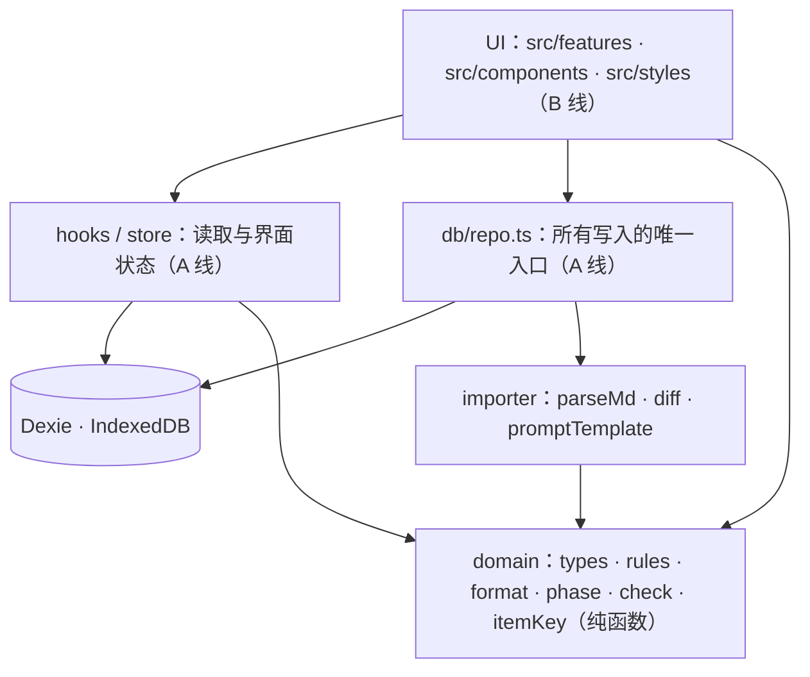
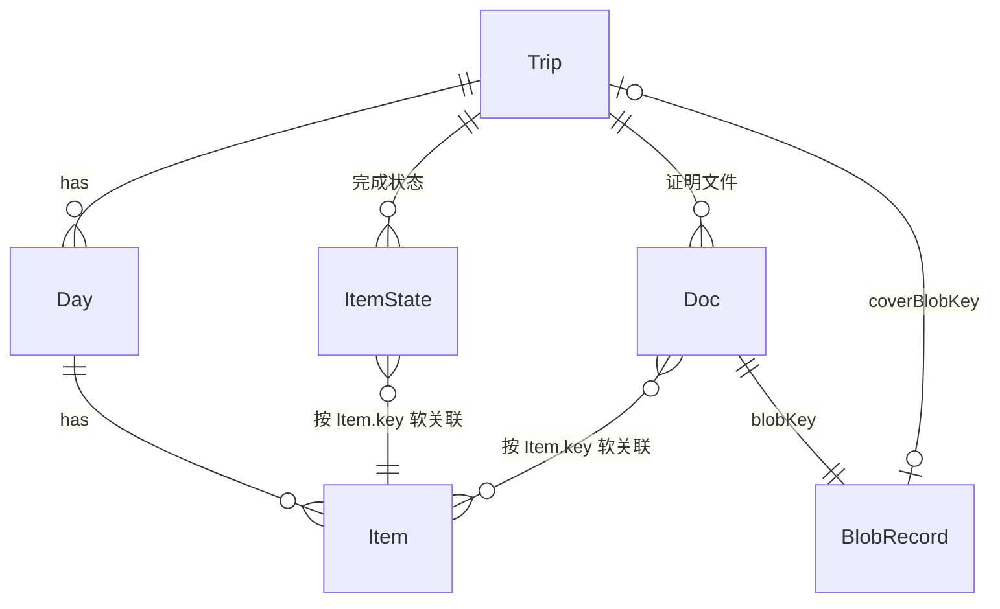
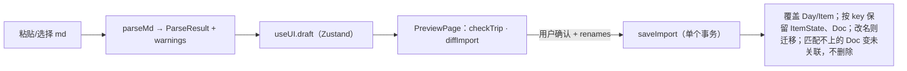

# 架构与数据结构（B 线只读）

本地优先：所有数据在浏览器 IndexedDB（Dexie），无后端。行程由外部 AI 生成 md，App 解析后存库。

## 分层（依赖只能向下）

## 数据模型

- **导入内容**（每次重新导入会被整体覆盖）：Trip、Day、Item，id 每次重新生成。
- **用户内容**（重新导入必须保留）：ItemState、Doc、BlobRecord。它们**不引用 Item.id**，只引用 `Item.key`。
- `Item.key = 日期|type|标题slug`（同日重名加 `#n`）。这是整个 App 最关键的契约。

## 导入 / 重新导入

## 其他要点
- 时间是当地时间字符串 + `Day.tz`，不存 UTC。`navUrl` 由外部 AI 写入。
- 备份：zip（`backup.json` + `files/*`），恢复用 bulkPut 合并。
- 旅行阶段 `tripPhase` 只看日期，不凭时钟推断完成；完成状态只来自用户手动标记。
