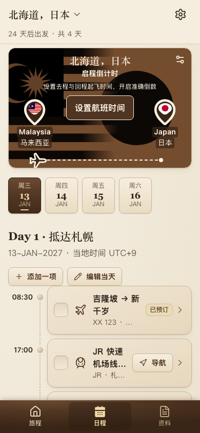
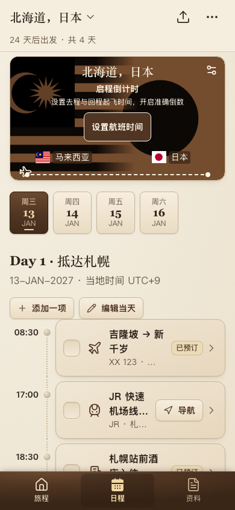
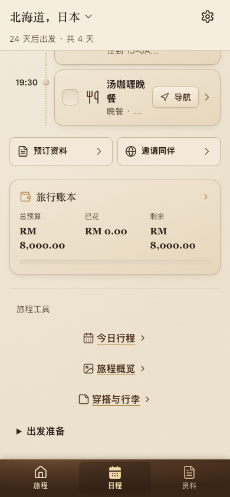
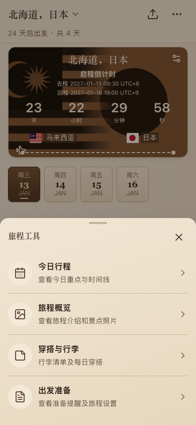
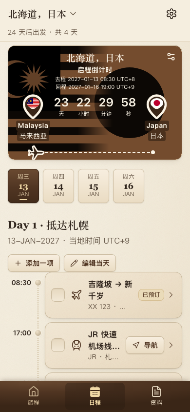
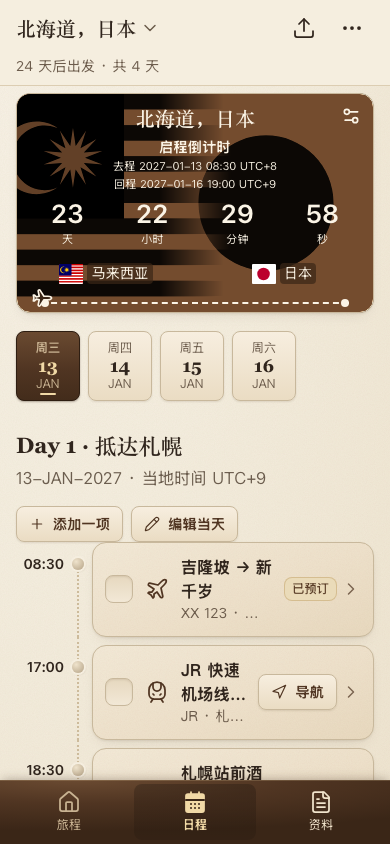
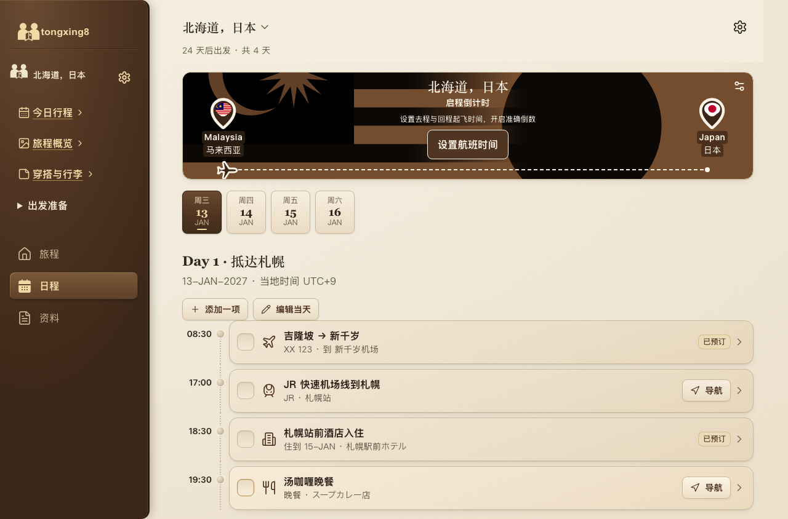

# 每日行程手机布局验收

基线：`0af955f`（最新 main，包含 #43 及 #50–#56）。2026-10-20 验证。仅 UI 改动，未合并或部署生产。

## 改动

- 手机 <768px：页头分享入口指向原有 `settings#sync`；44×44 的「打开旅程工具」打开现有 Sheet。原页面内工具列表仅在平板保留，电脑侧栏不变。
- 今日行程仍按原显示条件进入 `/trip/:id/today`，并未改为底部「日程」；出发前该页面显示首日，结束后显示末日，因此文案使用「查看今日重点与时间线」，不声称强制跳到当前日期。
- 旅程概览 `/story`、穿搭与行李 `/outfits` 保持原行为；出发准备通过第二张 Sheet 展示原 PhaseCard 和「查看准备事项」，包括原有已结束统计/备份行为。
- 倒计时复用原真实设置、时间计算和保存流程。仅每日行程手机端压缩布局；已设置时没有中央设置按钮，右上按钮名称为「编辑航班时间」。国家修改入口仍可用。其他页面及 ≥768px 的卡片不变。
- 手机各阶段的倒计时在日期选择之前，日期选择逻辑和数据不变。
- 修复现有遮罩滚动锁：页面 html/body 使用 `overflow-x: clip`，只锁 body 时遮罩上滚轮会推动背景。复用 overlay 栈，同时锁定 html，并在最后一层关闭后还原原来的两个 overflow 值；原焦点约束、inert、Escape 机制保持不变。

## 实测

同一仓库示例 `qa/sample-v2.md`，同一固定测试时钟（2026-12-20 02:00 UTC），相同设备/视口、语言、时区。通过导入及原航班设置 UI 创建浏览器内隔离测试资料，未访问真实旅程或 Supabase。前后图均来自本地运行的真实页面，不是设计稿。

| 390×844 状态 | 日期区 y：之前 → 之后 | 实际上移 | 首项行程底部 y |
|---|---|---|---|
| 未设置航班 | 343.50 → 315.19 | 28.31px | 623.19 |
| 已设置航班 | 343.50 → 328.78 | 14.72px | 636.78 |

底部导航从 y=780 开始，两种状态均无需滚动即可完整看到日期、当天标题和第一项行程。最新 main 的工具区原本在页面底部，不能算作首屏节省高度；#50 已移除的「下一站」卡片没有被恢复，也不计为本 PR 的节省。长标题/放大文字会自然增加高度，不承诺所有内容都能首屏显示。

768、1280 首页前后截图逐像素一致；各定位测量值一致。360、390、430 均无页面横向溢出。

## 截图

| 场景 | 修改前 | 修改后 |
|---|---|---|
| 手机首页（390×844，未设航班） |  |  |
| 工具入口（原版没有抽屉，前图为原工具区） |  |  |
| 航班已设置（390×844） |  |  |
| 桌面（1280×844） |  |  |

目录另含 360/430/768 截图、200% 字体与 34px 安全区、四季主题、已出发/已结束截图，以及原始 measurements.json。

## 验证结果与限制

- `npm run build`：通过。
- `npm test`：24 文件、231 项通过。
- 新 UI 验收 `qa/mobile-tools/check.py`：360/390/430/768/1280；四个工具入口、分享原路由、44px 热区、Tab/Shift+Tab 焦点循环、Escape/遮罩/关闭按钮、焦点恢复、背景 inert、滚动锁及原位置、日期选择、航班修改和刷新、200% 字体/长标题/安全区、四季主题、已出发及结束状态通过。
- `git diff --check`：通过。
- 桌面/平板首页像素对比：无差异。测试使用无 Service Worker 的隔离 Chromium；未宣称真机 iOS Safari 验证。
- **guard 不通过，未改 guard 或锁文件**：两处 TripTools 的 `useState`（抽屉开关）和 ItineraryPage 的 `useBreakpoint` import 被分工检查拒绝。该任务明确要求这些界面交互；数据锁定区哈希无变化。提交供审查，不自动合并。
- 数据、类型、数据库、权限、同步、导入、业务路由、机票计算均未修改。`src/hooks/layout.ts` 是现有 UI 布局/遮罩文件，也是 guard 的已有豁免文件。

## 给另一条线

请审查本任务明确授权的三个 UI 状态/布局行。无需数据字段或业务逻辑支持；未通过更改分支命名、guard 配置、哈希锁或弱化断言来规避检查。

## 复现

安装项目依赖并运行 Vite。使用单独 Python 环境安装 Playwright，运行：

```sh
QA_URL=http://127.0.0.1:4228 python qa/mobile-tools/check.py before
QA_URL=http://127.0.0.1:4227 python qa/mobile-tools/check.py after
```

before 服务必须来自上述基线的独立 checkout，after 服务来自 PR 分支。预览 URL 也可作为 QA_URL；脚本只使用其自己的新浏览器上下文和本地导入资料。

## Netlify PR Preview

[Preview #57](https://deploy-preview-57--tongxing8.netlify.app) 的 `c4be432` 部署状态 ready；同一套五视口/交互验收全部通过，已人工检查 390/768/1280 截图。证据见 `preview/`。验收屏蔽 Netlify 注入的 `/.netlify/scripts/cdp` 审阅工具栏（它覆盖手机点击），只影响隔离测试上下文，没有改站点配置。生产未部署。

- [390 工具抽屉](preview/390-tools.png)
- [768 页面](preview/768-home.png)
- [1280 页面](preview/1280-home.png)
- [预览验收测量](preview/measurements.json)
